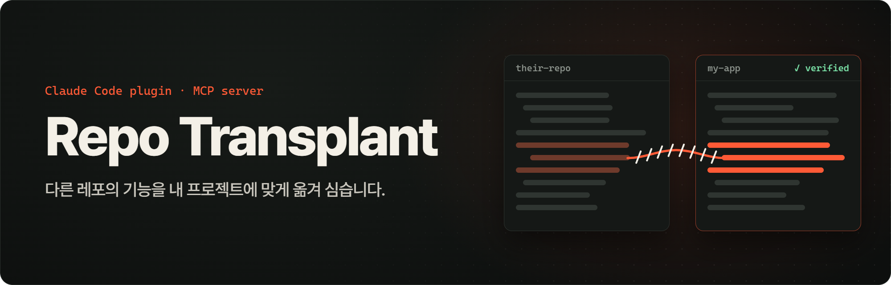
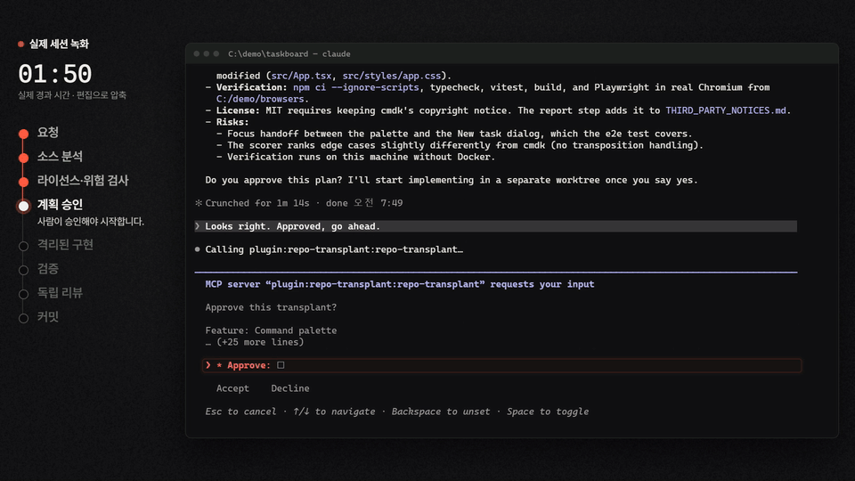
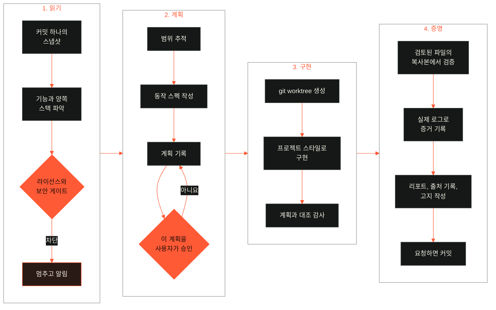

<p align="center">
  
</p>

<p align="center">
  <strong>GitHub URL과 원하는 기능을 한 문장으로 말하세요.</strong><br>
  Claude Code가 기능을 찾아 내 스택과 디자인에 맞게 다시 구현하고, 실제로 동작함을 증명합니다. 프론트엔드도 백엔드도 됩니다.
</p>

<p align="center">
  <a href="https://github.com/hs-hui/repo-transplant/actions/workflows/ci.yml"></a>
  <a href="CHANGELOG.md"></a>
  <a href="LICENSE"></a>
  
  
</p>

<p align="center">
  <a href="#설치">설치</a>
  &nbsp;·&nbsp;
  <a href="#이식-절차">이식 절차</a>
  &nbsp;·&nbsp;
  <a href="#실제-프로젝트-평가">평가 결과</a>
  &nbsp;·&nbsp;
  <a href="#한계">한계</a>
  &nbsp;·&nbsp;
  <a href="README.md">English</a>
</p>

<br>

```text
> github.com/pacocoursey/cmdk의 커맨드 팔레트를 이 프로젝트에 추가해줘. 기존 디자인은 유지해.
```

<p align="center">
  
  <br>
  <sub>작은 데모 앱에서 실제로 돌린 세션입니다. 약 10분을 14초로 줄였고, Claude에게 보낸 답변은 스크립트로 입력했습니다.</sub>
</p>

## 무엇이 달라지나

Claude는 이미 레포를 읽고 코드를 쓸 수 있습니다. 부족한 것은 믿고 맡길 수 있는 절차입니다. Repo Transplant는 그 절차를 코드로 강제하는 MCP 서버와, 작업을 이끄는 Skill을 제공합니다.

| 규칙 | 의미 |
| --- | --- |
| **초기 차단** | 라이선스가 재사용을 금지하거나 코드가 악성으로 보이면 코드를 쓰기 전에 멈춥니다. |
| **동작 우선** | 프레임워크와 무관한 스펙과 수용 기준을 먼저 만들고, 코드는 스펙에서 나옵니다. 그래서 React에서 Vue로, Express에서 Fastify로 옮기는 작업도 같은 절차입니다. |
| **계획 승인** | 파일, 패키지, 마이그레이션, 환경변수, 실행 명령이 모두 담긴 계획 하나를 승인합니다. 계획이 바뀌면 승인은 무효가 됩니다. |
| **범위 감사** | 결과를 계획과 대조해, 계획을 벗어난 변경을 모두 잡아냅니다. |
| **성공의 증거** | 자동 검증 기준은 통과한 테스트를 가리켜야 하고, 그 이름이 실제 로그에 있어야 하며, 지금 디스크에 있는 트리 기준이어야 합니다. 한 줄이라도 고치면 증거는 무효가 됩니다. |

작업 트리는 건드리지 않습니다. 모든 작업은 별도 브랜치의 git worktree에서 진행되고, 검사는 검토한 파일만으로 만든 별도 복사본에서 실행됩니다.

## 설치

### Claude Code 플러그인 (권장)

Skill, 에이전트 2개, 서버, 그리고 요청을 Skill로 이어주는 훅이 포함됩니다. Node.js 20.11 이상과 git이 필요합니다. Docker는 선택 사항이며 컨테이너 검증에 쓰입니다.

```bash
claude plugin marketplace add hs-hui/repo-transplant
```

```bash
claude plugin install repo-transplant@repo-transplant
```

이후 평소처럼 말하거나 `/repo-transplant:transplant <url> <기능>`을 실행하면 됩니다.

### MCP 서버만 사용

MCP를 지원하는 모든 클라이언트에서 쓸 수 있습니다.

```bash
claude mcp add repo-transplant -- npx -y repo-transplant-mcp
```

```json
{
  "mcpServers": {
    "repo-transplant": { "command": "npx", "args": ["-y", "repo-transplant-mcp"] }
  }
}
```

서버 자체에 작업 절차가 포함돼 있고 `transplant` 프롬프트도 제공합니다. 백엔드, UI, 프레임워크 간 이식 플레이북은 플러그인에만 있습니다.

## 이식 절차



모든 단계는 서버가 강제합니다. 순서를 건너뛸 수 없고, 검증 후 수정하면 검증이 무효가 됩니다. 코드가 바뀌거나 검사가 실패하면 구현 단계로 돌아갑니다. 계획이 틀렸다고 밝혀지면 새 계획을 기록할 수 있습니다. worktree는 유지되고, 이전 검증은 지워지며, 다시 승인받아야 합니다.

## 실제 프로젝트 평가

실제 Claude Code 세션에 사용자가 말하듯 한 문장으로 요청하고, 에이전트의 보고를 믿는 대신 결과를 직접 확인했습니다. **이식 요청 25건 중 22건이 `complete`에 도달했고, 3건은 멈춰서 사람에게 물었으며, 25건 모두 메인 체크아웃을 건드리지 않았습니다.**

| 기능 | 소스 → 타깃 | 직접 확인한 내용 |
| --- | --- | --- |
| 커맨드 팔레트 | cmdk → [bulletproof-react](https://github.com/alan2207/bulletproof-react) | 앱의 목 API에 붙여 브라우저에서 사용. 테스트 41개 통과. |
| 로그인 속도 제한 | slowapi → [FastAPI template](https://github.com/fastapi/full-stack-fastapi-template) | Docker의 Postgres로 백엔드 전체 실행: 75개 통과. |
| 로그인 잠금 | django-axes → [Django Styleguide](https://github.com/HackSoftware/Django-Styleguide-Example) | 74개 통과, 동작 검사 6건 유지. |
| Gzip | gin-contrib/gzip → [Go realworld app](https://github.com/gothinkster/golang-gin-realworld-example-app) | Docker에서 전체 실행. 실패 1건은 베이스 커밋에서도 같은 실패. |
| 연결 속도 제한 | tower → [mini-redis](https://github.com/tokio-rs/mini-redis) | Docker에서 전체 실행: 모든 테스트 타깃 통과. |
| Stripe 결제 | stripe-samples checkout → Flask, SQLite | 위조 서명과 재전송을 포함한 검사 15건 통과. 실제 Stripe가 아닌 서명된 이벤트로 시험. |
| 라이선스 게이트 | Mastodon (AGPL-3.0) → 비공개 유료 SaaS | 차단. 세션을 열지 않았고 아무것도 쓰지 않음. |

도중에 나온 실패와 수정까지 포함한 전체 기록은 [docs/evaluation.md](docs/evaluation.md)에 있습니다.

## 백엔드 기능

백엔드 이식은 위험이 더 크기 때문에 라우트를 옮기는 데서 끝나지 않습니다.

| 영역 | 동작 |
| --- | --- |
| **API 라우트** | Express, Fastify, Hono, NestJS, tRPC, Next.js, SvelteKit, FastAPI, Flask, Django, Gin, Echo, chi, Rails, Laravel, Spring, ASP.NET, Axum, Rocket을 인식합니다. 스펙에는 라우트마다 호출 권한을 적어야 합니다. |
| **데이터 모델** | Prisma, Drizzle, Mongoose, TypeORM, Sequelize, SQLAlchemy, Django, GORM, ActiveRecord, Eloquent, JPA, EF Core, SQL을 인식합니다. 스키마 파일은 임포트되지 않는 경우가 많아 이름으로 기능에 연결합니다. |
| **마이그레이션** | 그대로 복사하지 않습니다. 계획에 롤백이 포함된 새 마이그레이션이 있어야 하고, 파괴적 구문은 선언해야 합니다. 선언하지 않으면 감사에서 잡힙니다. |
| **시크릿** | pydantic 설정과 `.env.example`을 포함해 코드가 읽는 환경변수를 스펙에서 모두 다뤄야 합니다. 실제 `.env` 파일은 차단됩니다. |
| **잡과 실시간** | BullMQ, Celery, Sidekiq, cron, WebSocket, SSE 위치를 찾아 빠뜨리지 않게 합니다. |
| **검증용 데이터베이스** | `verification.services`가 Postgres 같은 서비스를 인터넷이 없는 Docker 사설 네트워크에서 실행합니다. 다른 곳을 가리키는 연결 문자열은 거부합니다. |

추적 지원 언어는 JavaScript, TypeScript, Vue, Svelte, Astro, Python, Go, Rust, Ruby, PHP, Java, Kotlin과 CSS 임포트입니다. C#은 라우트와 모델은 찾지만 using을 파일로 연결하지는 않습니다.

## 다른 사용 방법

- **"이거 옮길 수 있어?"** 평가까지만 하고 멈춥니다. 아무것도 쓰지 않습니다.
- **여러 기능 이식:** 기능마다 세션을 만들고, `transplant_commit` 뒤에 `base_ref`로 쌓습니다.
- **레포 간 직접 이식:** `repo_clone_target` 후 같은 절차로 진행합니다. 클론은 프로젝트 밖에 있어 Claude Code가 편집 권한을 묻습니다. PR은 요청할 때만 엽니다.
- **원본이 바뀌었을 때:** `transplant_check_upstream`이 `.transplant/provenance`를 읽어, 이식 대상 파일에서 바뀐 내용을 보여줍니다.

## 레포에 남는 것

| 경로 | 내용 |
| --- | --- |
| `transplant/<세션>` 브랜치 | 커밋하면 남는 기능과 테스트 |
| `.transplant/reports/<세션>.md` | 변경 내용, 입증된 것, 사람이 확인할 것 |
| `.transplant/provenance/<세션>.json` | 원본 커밋, 파일 매핑, 라이선스 |
| `THIRD_PARTY_NOTICES.md` | 라이선스가 요구할 때의 저작권 고지 |
| `.transplant/worktrees/` | 로컬 worktree. git에서 자동 제외됩니다 |

리포트와 출처 기록을 히스토리에 남기지 않으려면 `transplant_commit`에 `include_records: false`를 넘기세요. `transplant_check_upstream`에는 출처 기록이 필요합니다. 메인 체크아웃의 `npm test`가 `.transplant/worktrees/` 안의 파일까지 실행한다면, 테스트 러너의 제외 목록에 이 경로를 추가하거나 세션을 먼저 끝내세요.

<details>
<summary><strong>도구 31개 전체</strong></summary>

<br>

| 도구 | 용도 |
| --- | --- |
| `repo_fetch` | 커밋 하나에 고정된 읽기 전용 스냅샷. 훅, 심볼릭 링크, 서브모듈은 비활성화 |
| `repo_clone_target` | 레포 간 작업용 쓰기 가능한 클론 |
| `repo_profile` | 스택, 컨벤션, 디자인 토큰, 검증 명령 |
| `repo_tree`, `repo_read_file` | 스냅샷 탐색. 내용은 신뢰할 수 없는 것으로 표시 |
| `license_check` | 소스와 타깃의 라이선스, 중첩 라이선스, SPDX 헤더 |
| `security_scan` | 프롬프트 주입, 숨은 유니코드, 설치 훅, 시크릿, 바이너리 |
| `feature_search` | 설명에 맞는 파일 순위. 영어와 한국어 지원 |
| `feature_trace` | 연결된 파일, 공유 모듈, 패키지, 테스트, 진입점, 백엔드 표면 |
| `backend_surface` | 라우트, 모델, 마이그레이션, 환경변수, 잡, 서비스 |
| `stack_compare` | 스택 차이와 패키지별 재사용, 교체, 추가, 충돌 판단 |
| `package_inspect` | npm, PyPI, crates.io의 패키지 존재 여부, 라이선스, 경과 기간 확인 |
| `assess_feasibility` | 아무것도 쓰기 전에 항목별 작업량과 위험 점수 산정 |
| `transplant_start` | 세션을 열고 게이트 실행 |
| `transplant_trace` | 범위를 확정하고 그 파일들을 다시 검사 |
| `transplant_record_spec` | 동작 계약 저장과 검증 |
| `transplant_record_plan` | 계획을 저장하고 승인 요약 반환 |
| `transplant_approve` | 사용자 승인을 계획 해시에 묶음 |
| `transplant_create_workspace` | 격리된 worktree 생성 |
| `transplant_audit` | worktree를 계획과 비교 |
| `transplant_verify` | 검토된 파일의 복사본에서 승인된 명령 실행 |
| `transplant_baseline` | 같은 명령을 베이스 커밋에서 실행해 기존 실패와 새 실패를 구분 |
| `transplant_record_evidence` | 기준을 로그로 입증된 결과에 연결 |
| `transplant_report` | 리포트, 출처 기록, 제3자 고지 작성 |
| `transplant_commit` | 요청하면 검토된 파일 그대로 커밋 생성 |
| `transplant_cleanup` | 머지 후 worktree와 브랜치 제거 |
| `transplant_status`, `transplant_list` | 진행 상황 확인 |
| `transplant_discard` | worktree와 브랜치 제거 |
| `transplant_check_upstream` | 라이선스 변경을 포함해 원본에서 바뀐 내용 확인 |
| `visual_compare` | 스크린샷 두 장의 픽셀 비교 |

</details>

<details>
<summary><strong>설정</strong></summary>

<br>

| 변수 | 기본값 | 용도 |
| --- | --- | --- |
| `RT_HOME` | `~/.repo-transplant` | 스냅샷과 세션 저장 위치 |
| `RT_ALLOWED_HOSTS` | `github.com` | 허용할 git 호스트, 쉼표로 구분 |
| `RT_MAX_REPO_MB` | `2048` | 가져올 레포 최대 크기 |
| `RT_GIT_TIMEOUT_MS` | `300000` | git 네트워크 제한 시간 |
| `RT_MAX_FILE_BYTES` | `1048576` | 분석할 파일 최대 크기 |
| `RT_MAX_OUTPUT_CHARS` | `60000` | 도구 응답 최대 길이 |
| `RT_WORKTREE_ROOT` | 없음 | worktree를 프로젝트 안 대신 이 폴더에 둡니다. 테스트 러너가 깨끗해지지만, 클라이언트가 그 폴더의 편집 권한을 물을 수 있습니다. |
| `RT_ALLOW_ATTESTED` | 없음 | `1`이면 승인 창이 없는 클라이언트에서 예외 승인과 high 지적 수락을 에이전트의 말로 처리합니다. |
| `RT_REQUIRE_DIALOG` | 없음 | `1`이면 클라이언트가 승인 창을 즉시 취소할 때 에이전트가 기록한 말을 받지 않습니다. 이 값을 켜면 헤드리스 실행은 승인할 수 없습니다. |

비공개 레포는 기존 git 인증 정보로 동작합니다. 스냅샷은 지우기 전까지 `RT_HOME`에 남습니다. 진행 중인 세션이 없을 때는 지워도 안전합니다.

</details>

## 한계

무엇을 시험했고 무엇을 안 했는지는 [docs/evaluation.md](docs/evaluation.md)에 있습니다.

사용 전에 알아둘 점입니다.

- **라이선스 검사는 휴리스틱이며 법률 자문이 아닙니다.** 주요 라이선스를 비교할 뿐, 재작성한 코드가 파생물인지는 판단하지 못합니다.
- **보안 스캔은 패턴 매칭입니다.** 위험을 줄여주지만, 깨끗하다는 결과가 안전을 보장하지는 않습니다. 병합할 코드는 직접 검토하세요.
- **검증은 기본적으로 내 컴퓨터에서 실행되며, 샌드박스가 아닙니다.** 허용 목록으로 줄인 환경변수와 임시 홈 디렉터리를 쓰지만, 파일을 읽거나 네트워크를 쓰는 것까지 막지는 못합니다. 낯선 곳의 코드가 AI를 거쳐 온 것이니, 실행 전에 읽어보세요. 계획에 `verification.docker_image`를 지정하면 그 복사본을 컨테이너에서 실행합니다. 설치 단계를 제외하면 네트워크가 꺼진 상태로 실행됩니다. `verification.services`로 데이터베이스 같은 서비스를 사설 네트워크에 함께 띄울 수 있습니다.
- **추적은 임포트를 따라갑니다.** Rails 오토로딩, Django 설정 문자열, DI 컨테이너 같은 프레임워크 동작은 잡히지 않고, 라우트의 인증 힌트는 텍스트 매칭입니다. 스펙 단계가 이 부분을 보완합니다.
- **승인 방식은 클라이언트에 따라 다릅니다.** MCP elicitation을 지원하면 계획, 예외 승인, 감사 항목 수용을 사용자에게 직접 묻습니다. 그렇지 않으면 에이전트가 전달한 사용자의 말을 기록하며, 서버가 이를 검증할 수는 없어 리포트에 에이전트 기록으로 표시합니다. 예외 승인과 high 지적 수락은 `RT_ALLOW_ATTESTED=1`이 없으면 승인 창이 있어야 합니다. 헤드리스 Claude Code는 elicitation을 지원한다고 알리면서 모든 요청을 몇 밀리초 안에 취소하므로, `RT_REQUIRE_DIALOG=1`을 켜지 않으면 그렇게 빠른 취소도 같은 방식으로 처리됩니다. 사람이 승인 창을 닫으면 거부로 처리됩니다.
- **큰 파일에 다른 기능과 섞인 기능**은 파일 단위로 추적됩니다. 경계는 스펙에서 정합니다.
- **브랜치 이름이 아니라 커밋을 머지하세요.** `transplant_commit`은 검토된 파일 그대로 커밋을 만들고 그 해시를 돌려줍니다. worktree에서 직접 커밋하면 이 보장이 사라집니다.
- **테스트를 통과해도 실제 경로에서는 틀릴 수 있습니다.** 서버는 지정한 테스트가 정확히 그 코드에서 통과했음을 증명할 뿐, 그 테스트가 실제 운영 데이터를 썼는지는 증명하지 못합니다. 평가 중 UI 필터가 테스트 데이터로는 통과하고 앱의 실제 명령으로는 틀린 사례가 있었습니다. UI 기능은 머지 전에 직접 써보세요.
- **worktree는 프로젝트 안에 있습니다.** Vitest나 Jest처럼 점(.) 디렉터리를 탐색하는 러너는 머지하거나 버리기 전까지 본 체크아웃에서 worktree의 테스트도 함께 실행합니다. worktree에 패키지를 설치하면 이 실행이 실패할 수 있습니다. `RT_WORKTREE_ROOT`를 설정하면 피할 수 있습니다. Claude Code에서는 그 폴더를 `--add-dir`로 함께 추가해야 편집마다 권한을 묻지 않습니다.

## 개발

```bash
npm ci
```

```bash
npm run check
```

```bash
node scripts/smoke.mjs
```

`plugin/dist/server.mjs`는 플러그인이 설치 단계 없이 실행되도록 커밋합니다. 오래된 번들이면 CI가 실패합니다. [CONTRIBUTING.md](CONTRIBUTING.md)를 참고하세요. 위협 모델은 [SECURITY.md](SECURITY.md)에 있습니다.

## 라이선스

[MIT](LICENSE). 번들에 포함된 의존성은 [plugin/dist/THIRD_PARTY_LICENSES.md](plugin/dist/THIRD_PARTY_LICENSES.md)에 있습니다.
