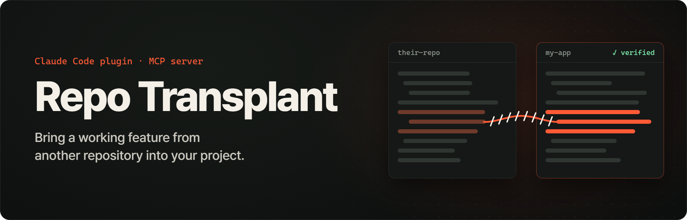
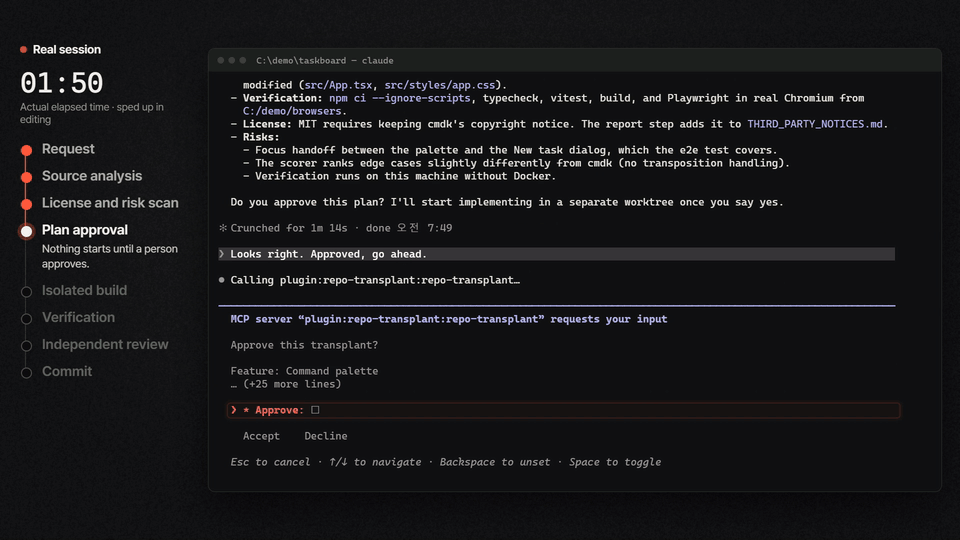
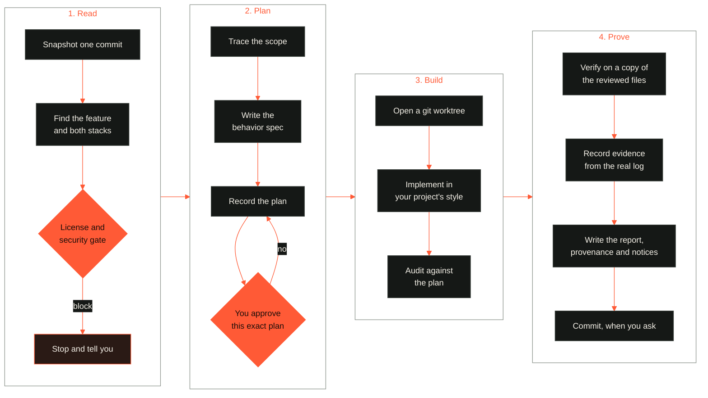

<p align="center">
  
</p>

<p align="center">
  <strong>Give Claude Code a GitHub URL and a sentence.</strong><br>
  It finds the feature, rebuilds it for your stack and design, and proves it works. Frontend or backend.
</p>

<p align="center">
  <a href="https://github.com/hs-hui/repo-transplant/actions/workflows/ci.yml"></a>
  <a href="CHANGELOG.md"></a>
  <a href="LICENSE"></a>
  
  
</p>

<p align="center">
  <a href="#install">Install</a>
  &nbsp;·&nbsp;
  <a href="#how-a-transplant-runs">How it runs</a>
  &nbsp;·&nbsp;
  <a href="#tested-on-real-projects">Results</a>
  &nbsp;·&nbsp;
  <a href="#limits">Limits</a>
  &nbsp;·&nbsp;
  <a href="README.ko.md">한국어</a>
</p>

<br>

```text
> Add the command palette from github.com/pacocoursey/cmdk to this project. Keep our design.
```

<p align="center">
  
  <br>
  <sub>A real session on a small demo app, about 10 minutes cut to 14 seconds. The replies to Claude were scripted.</sub>
</p>

## What it adds

Claude can already read a repository and write code. What it lacks on its own is a process you can trust. Repo Transplant adds that process as an MCP server whose gates are enforced in code, plus a skill that guides the work.

| Rule | What it means |
| --- | --- |
| **Stop early** | If the license forbids reuse, or the code looks hostile, it stops before writing any code. |
| **Behavior first** | A framework-independent spec with acceptance criteria comes first, and code comes from the spec. React to Vue or Express to Fastify is the same workflow. |
| **One exact plan** | You approve its files, packages, migrations, env vars and commands. Changing the plan voids the approval. |
| **Scope audit** | The result is compared with the plan, and anything outside it is flagged. |
| **Proof of success** | Each automated criterion must point at a passing test, named in the real log, for the exact tree on disk. Edit a line and that evidence is void. |

Your working tree stays untouched. All work happens in a git worktree on its own branch, and checks run in a separate copy built from exactly the files that were reviewed.

## Install

### As a Claude Code plugin (recommended)

Includes the skill, two agents, the server and a hook that routes requests to the skill. Needs Node.js 20.11 or later and git. Docker is optional, and needed for container checks.

```bash
claude plugin marketplace add hs-hui/repo-transplant
```

```bash
claude plugin install repo-transplant@repo-transplant
```

Then ask in plain words, or run `/repo-transplant:transplant <url> <feature>`.

### As an MCP server only

For any MCP client:

```bash
claude mcp add repo-transplant -- npx -y repo-transplant-mcp
```

```json
{
  "mcpServers": {
    "repo-transplant": { "command": "npx", "args": ["-y", "repo-transplant-mcp"] }
  }
}
```

The server carries its workflow in its instructions and offers a `transplant` prompt. The skill's playbooks for backend, UI and cross-framework work are plugin-only.

## How a transplant runs



Every stage is enforced by the server. A step cannot run early, and an edit after verification invalidates it, so changed code or a failed check goes back to implementation. If the plan turns out wrong, a new one keeps the worktree, clears the checks and needs your approval again.

## Tested on real projects

Real Claude Code sessions got a one-line request, as a user would give it, and we checked each result ourselves instead of trusting the agent's report. **Of 25 transplant requests, 22 reached `complete`, 3 stopped to ask a person, and all 25 stayed out of the main checkout.**

| Feature | Source → target | Our check |
| --- | --- | --- |
| Command palette | cmdk → [bulletproof-react](https://github.com/alan2207/bulletproof-react) | Used in a browser against the app's mock API. 41 tests pass. |
| Login rate limit | slowapi → [FastAPI template](https://github.com/fastapi/full-stack-fastapi-template) | The whole backend suite on Postgres in Docker: 75 pass. |
| Login lockout | django-axes → [Django Styleguide](https://github.com/HackSoftware/Django-Styleguide-Example) | 74 pass, and 6 behavior probes hold. |
| Gzip | gin-contrib/gzip → [Go realworld app](https://github.com/gothinkster/golang-gin-realworld-example-app) | Full suite in Docker. The one failure also fails on the base commit. |
| Connection rate limit | tower → [mini-redis](https://github.com/tokio-rs/mini-redis) | Full run in Docker: every test target passes. |
| Stripe payments | stripe-samples checkout → Flask with SQLite | 15 probes pass, including forged signatures and replay. Tested with signed events, not live Stripe. |
| License gate | Mastodon (AGPL-3.0) → closed-source paid SaaS | Blocked. No session opened, nothing written. |

The full record, with the failures and fixes along the way, is in [docs/evaluation.md](docs/evaluation.md).

## Backend features

Backend transplants carry more risk, so the tools go further than copying routes.

| Surface | What happens |
| --- | --- |
| **API routes** | Found across Express, Fastify, Hono, NestJS, tRPC, Next.js, SvelteKit, FastAPI, Flask, Django, Gin, Echo, chi, Rails, Laravel, Spring, ASP.NET, Axum and Rocket. The spec must state who may call each route. |
| **Data models** | Prisma, Drizzle, Mongoose, TypeORM, Sequelize, SQLAlchemy, Django, GORM, ActiveRecord, Eloquent, JPA, EF Core and SQL. Linked to the feature by name, since schema files are rarely imported. |
| **Migrations** | Never copied. The plan needs a new migration with a rollback. Destructive statements must be declared, and the audit catches any that are not. |
| **Secrets** | Every env var the code reads, including pydantic settings and `.env.example`, must be covered in the spec. Real `.env` files are blocked. |
| **Jobs and realtime** | BullMQ, Celery, Sidekiq, cron, WebSocket and SSE sites are listed so nothing is left behind. |
| **Databases in checks** | `verification.services` runs Postgres and the like in Docker on a private network with no internet. Connection strings that point anywhere else are refused. |

Languages traced: JavaScript, TypeScript, Vue, Svelte, Astro, Python, Go, Rust, Ruby, PHP, Java and Kotlin, plus CSS imports. C# gets route and model detection, but its usings are not resolved to files.

## Other workflows

- **"Is this feasible?"** Stops after the assessment. Nothing is written.
- **Several features.** One session each, stacked with `base_ref` after each `transplant_commit`.
- **Repository to repository.** `repo_clone_target`, then the normal flow. The clone sits outside your project, so Claude Code asks permission for edits there. A pull request opens only when you ask.
- **Upstream changed.** `transplant_check_upstream` reads `.transplant/provenance` and shows what moved in the files your transplant came from.

## What ends up in your repository

| Path | Content |
| --- | --- |
| Branch `transplant/<session>` | The feature and its tests, once you commit |
| `.transplant/reports/<session>.md` | What changed, what was proven, what needs a person |
| `.transplant/provenance/<session>.json` | Source commit, file map and license |
| `THIRD_PARTY_NOTICES.md` | Attribution, when the license requires it |
| `.transplant/worktrees/` | Local worktrees, excluded from git automatically |

Pass `include_records: false` to `transplant_commit` to keep the report and provenance out of your history. `transplant_check_upstream` needs provenance. If `npm test` in your main checkout picks up files from `.transplant/worktrees/`, add that path to your test runner's ignore list, or finish the session first.

<details>
<summary><strong>All 31 tools</strong></summary>

<br>

| Tool | Purpose |
| --- | --- |
| `repo_fetch` | Read-only snapshot at one commit, with hooks, symlinks and submodules disabled |
| `repo_clone_target` | Writable clone for repository-to-repository work |
| `repo_profile` | Stack, conventions, design tokens and verification commands |
| `repo_tree`, `repo_read_file` | Browse a snapshot. Content is labeled untrusted |
| `license_check` | Source and target licenses, nested licenses and SPDX headers |
| `security_scan` | Prompt injection, hidden Unicode, install hooks, secrets and binaries |
| `feature_search` | Ranks files for a description, in English or Korean |
| `feature_trace` | Closure, shared modules, packages, tests, entry points and backend surface |
| `backend_surface` | Routes, models, migrations, env vars, jobs and services |
| `stack_compare` | Differences, and a reuse, replace, add or conflict decision per package |
| `package_inspect` | Confirms packages exist on npm, PyPI or crates.io, with license and age |
| `assess_feasibility` | Itemized effort and risk score, before anything is written |
| `transplant_start` | Opens a session and runs the gates |
| `transplant_trace` | Fixes the scope and rechecks those exact files |
| `transplant_record_spec` | Stores and validates the behavior contract |
| `transplant_record_plan` | Stores the plan and returns the approval summary |
| `transplant_approve` | Binds the user's approval to the plan hash |
| `transplant_create_workspace` | Creates the isolated worktree |
| `transplant_audit` | Compares the worktree with the plan |
| `transplant_verify` | Runs approved commands on a copy of the reviewed files |
| `transplant_baseline` | Runs those commands on the base commit, to separate old failures from new |
| `transplant_record_evidence` | Links criteria to log-proven results |
| `transplant_report` | Writes the report, provenance and third-party notices |
| `transplant_commit` | Builds a commit from the exact reviewed files, when you ask |
| `transplant_cleanup` | Removes the worktree and branch after you merge |
| `transplant_status`, `transplant_list` | Where things stand |
| `transplant_discard` | Removes the worktree and branch |
| `transplant_check_upstream` | What changed upstream, including license changes |
| `visual_compare` | Pixel diff of two screenshots |

</details>

<details>
<summary><strong>Configuration</strong></summary>

<br>

| Variable | Default | Purpose |
| --- | --- | --- |
| `RT_HOME` | `~/.repo-transplant` | Snapshots and sessions |
| `RT_ALLOWED_HOSTS` | `github.com` | Comma-separated git hosts |
| `RT_MAX_REPO_MB` | `2048` | Largest repository to fetch |
| `RT_GIT_TIMEOUT_MS` | `300000` | Git network timeout |
| `RT_MAX_FILE_BYTES` | `1048576` | Largest file analyzed |
| `RT_MAX_OUTPUT_CHARS` | `60000` | Largest tool response |
| `RT_WORKTREE_ROOT` | unset | Keep worktrees in this folder instead of inside the project. Test runners then stay clean, and your client may ask permission for edits there. |
| `RT_ALLOW_ATTESTED` | unset | Set to `1` to let overrides and accepted high findings rest on the agent's word when the client has no dialog. |
| `RT_REQUIRE_DIALOG` | unset | Set to `1` to refuse the agent's recorded words when a client cancels the dialog instantly. Headless runs cannot approve with this set. |

Private repositories work with your existing git credentials. Snapshots stay in `RT_HOME` until you delete them, which is safe whenever no session is running.

</details>

## Limits

[docs/evaluation.md](docs/evaluation.md) records what has been tried and what has not.

Worth knowing before you rely on it:

- **The license check is a heuristic, not legal advice.** It compares common licenses, and it cannot judge whether a rewrite is a derivative work.
- **The security scan is pattern matching.** It raises the bar, and a clean result does not prove safety. Review what you merge.
- **Verification runs on your machine by default, and that is not a sandbox.** Commands get an allowlisted environment and a temporary home directory, but they can still read your files and use the network. The code came from a stranger, then through an AI, so read it before running commands against it. A plan can set `verification.docker_image` to run that copy in a container, with the network off except during install. `verification.services` adds databases and the like on a private network.
- **Tracing follows imports.** Framework magic such as Rails autoloading, Django settings strings and dependency-injection containers does not show up as edges, and route auth hints are text matches. The spec step exists to catch this.
- **Approval depends on your client.** Clients with MCP elicitation ask you directly, for plans, overrides and accepted findings. Others record the agent's quote of your words for plan approval, which the server cannot verify, and the report labels it as agent-recorded. Overrides and accepted high findings need a dialog unless `RT_ALLOW_ATTESTED=1` is set. Headless Claude Code advertises elicitation and cancels every request within milliseconds, so a cancel that fast falls back the same way unless `RT_REQUIRE_DIALOG=1` is set. A person closing the dialog counts as a no.
- **A feature tangled into large files** traces at file level. The spec draws the line.
- **Merge the commit, not the branch name.** `transplant_commit` builds a commit from the exact files that were reviewed and returns its hash. Committing by hand in the worktree gives up that guarantee.
- **Passing tests can still miss the real path.** The server proves that a named test passed on the exact code, not that the test used what production uses. In one of our own runs a UI filter passed with fixture data and failed with the app's real commands. Use a UI feature by hand before you merge it.
- **The worktree sits inside your project.** Runners that scan dot directories, such as Vitest and Jest, also pick up its tests from the main checkout until it is merged or discarded. Installing packages in the worktree can make those runs fail. Set `RT_WORKTREE_ROOT` to avoid this. In Claude Code, also add that folder with `--add-dir`, or each edit asks for permission.

## Development

```bash
npm ci
```

```bash
npm run check
```

```bash
node scripts/smoke.mjs
```

`plugin/dist/server.mjs` is committed so the plugin runs with no install step. CI fails if it is stale. See [CONTRIBUTING.md](CONTRIBUTING.md), and [SECURITY.md](SECURITY.md) for the threat model.

## License

[MIT](LICENSE). Bundled dependencies are listed in [plugin/dist/THIRD_PARTY_LICENSES.md](plugin/dist/THIRD_PARTY_LICENSES.md).
